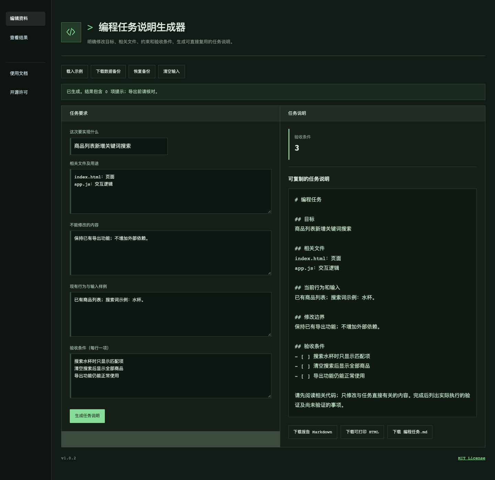

[README.md](https://github.com/user-attachments/files/34161240/README.md)
# 编程任务说明生成器

明确修改目标、相关文件、约束和验收条件，生成可直接复用的任务说明。

**v1.0.2 · MIT License**



## 快速开始

1. 下载并解压仓库，在浏览器中打开 `index.html`。
2. 点击“载入示例”了解操作，或填写自己的资料。
3. 点击“生成任务说明”，核对结果并下载所需文件。
4. 关闭页面前下载数据备份；下次可通过“恢复备份”继续。

应用完全在浏览器本地运行，无需安装依赖、注册账号或配置API。

## 输入与操作

- **这次要实现什么**：填写实际资料。
- **相关文件及用途**：填写实际资料。
- **不能修改的内容**：填写实际资料。
- **现有行为与输入样例**：填写实际资料。
- **验收条件（每行一项）**：填写实际资料。


## 结果与导出

“生成任务说明”后显示本项目成果；可导出Markdown报告、可打印HTML以及有表格时的CSV。专用成果（图片、ZIP、游戏、字幕或代码等）有独立下载按钮。HTML报告可用浏览器打印功能保存PDF。数据备份是本项目专用JSON，不与其他项目混用。


## 代码结构

- index.html / style.css：入口和基础界面。
- theme.css：产品视觉与响应式布局。
- app.js：本地操作、备份和导出。
- core.js：本项目业务处理，可独立用Node测试。
- common.js：CSV、日期、ZIP和安全文本处理等基础函数。
- project.js：字段定义与示例数据。
- examples/：可导入样例与CSV模板。
- tests/：可复现的逻辑测试。
- docs/：功能说明、验证记录和维护文档。
- SKILL.md：可选的AI助手技能入口；直接使用网页不依赖技能安装。

## 开发与验证

修改业务逻辑后，使用Node.js 18或更新版本执行：

```sh
node --test tests/core.test.cjs
```

界面修改后请验证资料输入、文件导出、备份恢复和窄屏布局。实际测试环境与结果见[验证记录](docs/验证记录.md)。

## 数据与隐私

输入和所选文件保存在当前页面内存中，不上传服务器。刷新或关闭页面前请下载备份；备份包含输入资料和附件。示例数据仅用于演示。

## 贡献

欢迎通过Issue报告问题，或通过Pull Request提交改进。请提供复现步骤及脱敏样例，参见[贡献说明](CONTRIBUTING.md)。

## 许可证

采用[MIT License](LICENSE)。使用、修改或分发时，请保留许可声明。
